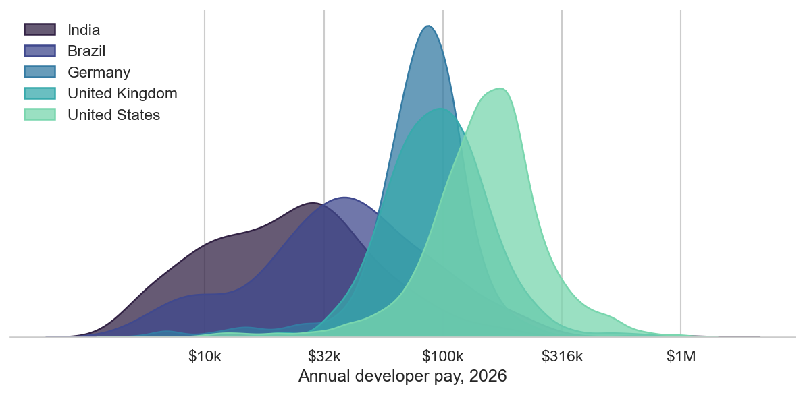
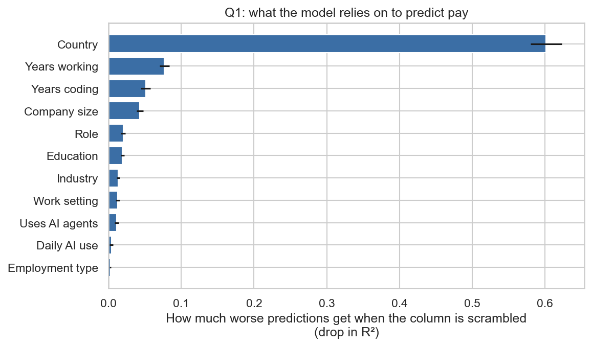
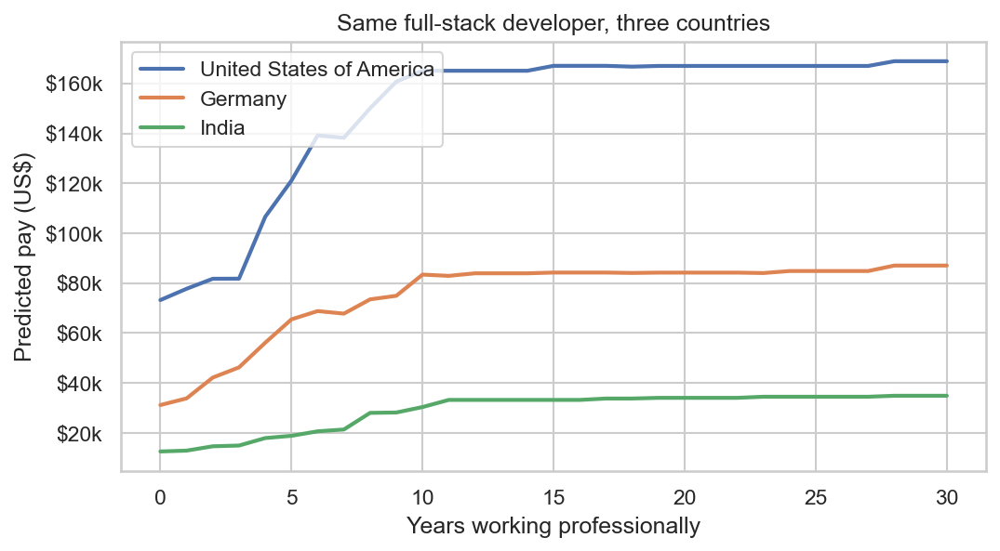
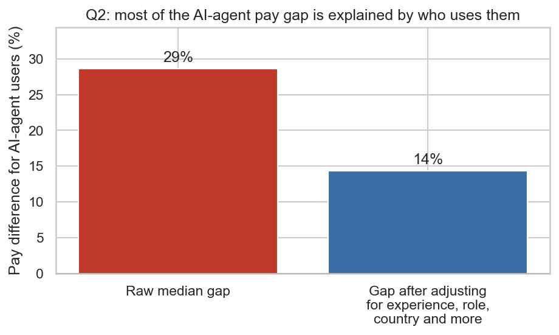
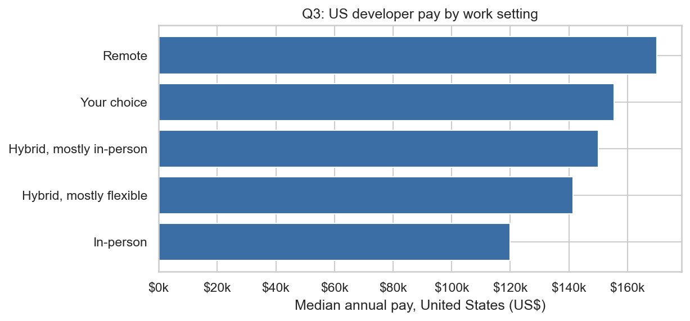
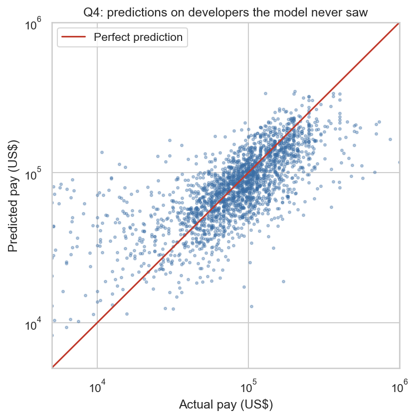
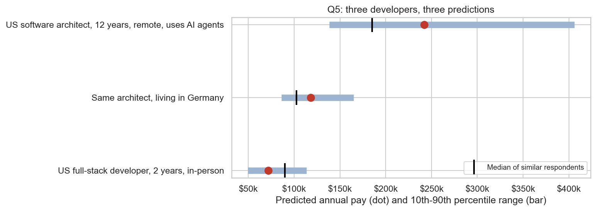

# Where you live beats what you code

*What 10,954 working developers told the 2026 Stack Overflow Developer Survey about their pay.*

Adopt AI agents. Go remote. Pick the right role. That is the advice every developer hears in 2026 about earning more.

I work in cloud architecture, and I wanted to know which of those actually moves pay. So I took the 30,903 answers to this year's survey, kept the 10,954 working developers who reported a salary, and put each piece of advice to the test.

## What drives developer pay?

I trained a model to predict salary, then scrambled one piece of information at a time to see how much worse it got. Country was not just first. It mattered about 8 times more than the runner-up, years of experience.

The typical US developer reports $151,000 a year. In India it is $22,981.

Experience matters next, but it levels off. For the same US developer, predicted pay rises from $73k at the start to $165k after ten years, then only to $167k after twenty.

## Do developers who use AI agents earn more?

Agent users report a median of $103,726, against $80,632 for everyone else: 29% more.

But agent users also tend to be more senior, in better-paid roles and countries. Compare otherwise identical developers and the gap falls to 14%. Real, but half of it was about who uses agents.

## Does remote work pay more?

In the US, remote developers report $170,000 and in-person developers $120,000. That gap is no fluke, but almost all of it comes from who works remotely. Hold everything else fixed and remote is worth about 4%.

## How well can pay be predicted?

On 2,191 developers the model never saw, its typical miss was $21,112, about 26% of salary. Guessing the same number for everyone misses by $33,385.

Asked a simpler question, above or below $85,296, it was right 78% of the time.

## Three developers, three predictions

A US software architect, twelve years in, remote, using AI agents: about $241,930. The same person in Germany: $118,104. A US full-stack developer two years in, in an office: $71,869.

The architect estimate sits above what similar respondents report ($185,000). A model stacks advantages more neatly than real careers do.

## What to take from this

- **Country sets the range.** The same job pays several times more in some countries than others.
- **Experience moves you up it,** mostly in the first ten years.
- **Remote work and AI agents matter less than they look** once you compare like with like.

**Your turn:** before your next pay conversation, find your country and experience in these charts. Does your pay fit the pattern? The [code and data are on GitHub](https://github.com/tyvee1/developer-pay-2026) if you want to test your own profile.

*Ty Verdell · Data: [Stack Overflow Developer Survey 2026](https://survey.stackoverflow.co/), Open Database License.*
